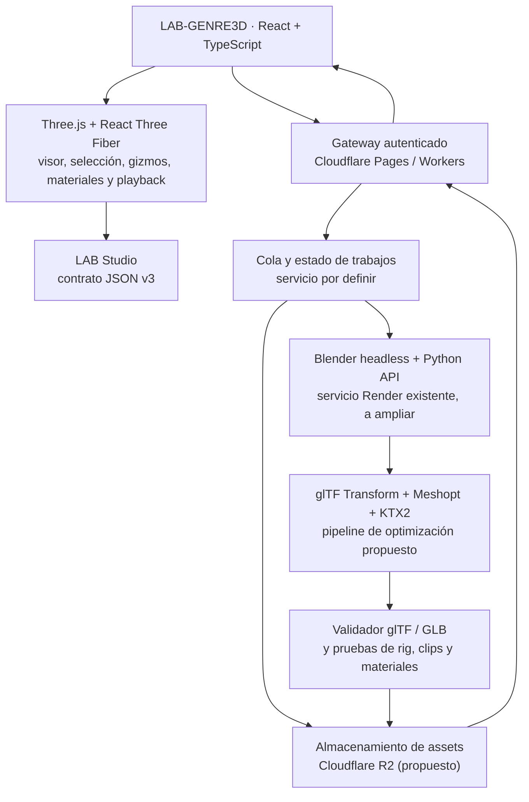

# LAB-GENRE3D — Arquitectura híbrida basada en motores probados

**Estado:** propuesta de arquitectura / decisión técnica para implementación incremental  
**Fecha:** 2026-11-03  
**Repositorio:** `ddepazos/LAB-GENRE3D`  
**Criterio:** reutilizar motores y bibliotecas consolidados; no reinventar un motor de modelado ni perder las funciones existentes.

> Este documento **no acredita implementación** de los componentes propuestos. Distingue la base ya documentada de la evolución pendiente. No implica cambios automáticos en LAB Studio ni en Cloudflare/Render.

## 1. Decisión principal

**LAB-GENRE3D será un editor web híbrido.** React + TypeScript + Three.js / React Three Fiber ofrecen el visor interactivo, las herramientas inmediatas y la previsualización; Blender, invocado como procesador externo mediante su API Python, realiza operaciones profesionales de malla, rigging, conversión de formatos y trabajos pesados. glTF/GLB es el formato de intercambio y visualización, **no** el único formato de autoría.

No reemplazar Three.js por otro motor en esta fase. No portar Blender al navegador. No reimplementar BMesh, importación FBX compleja o un motor booleano desde cero.

## 2. Estado previo comprobado en la documentación existente

- El editor utiliza React, TypeScript, Vite, Three.js y React Three Fiber; ya existen operaciones de visor, importación GLB/OBJ, transformación, selección, materiales PBR y exportación GLB. La disponibilidad exacta en producción debe verificarse tras cada despliegue.
- Existe un **puente Blender remoto real**, no es necesario inventar otro: `lab-genre3d-blender`, desplegado en Render, conectado mediante Cloudflare Pages Function `/api/blender/process` y protegido por Cloudflare Access. Véase [BLENDER-BRIDGE.md](./BLENDER-BRIDGE.md).
- El puente documentado ya procesó y retornó GLB al visor para **Suavizar, Normales, Subdividir y Reducir polígonos**. Según la documentación, opera con **entrada máxima 12 MB**, **salida máxima 40 MB**, **un trabajo concurrente** y **timeout de 90 s**. **No puede recibir tal cual el FBX de prueba cercano a 100 MB** sin una ampliación deliberada de infraestructura y flujo.
- Hay un contrato de intercambio previsto con LAB Studio en [LAB_CREATIVE_SUITE_INTEROPERABILIDAD.md](./LAB_CREATIVE_SUITE_INTEROPERABILIDAD.md) (JSON v3 + GLB y metadatos); se trata como especificación a validar, no compatibilidad integral ya certificada.
- El parche FBX local llegó a compilar y a conectar entradas, pero el usuario reportó que `Dying.fbx` bloquea el navegador. **Compilar no equivale a importar, animar ni editar correctamente.**

### Principio de conservación
Mantener el puente Blender existente y sus controles de seguridad. No modificar `plc-demo`, ni alterar LAB Studio, ni restaurar catálogos anatómicos experimentales descartados, ni sobrescribir trabajo local no confirmado. Se documentará cualquier migración futura antes de ejecutarla.

## 3. Arquitectura objetivo



**Precisión:** la cola de trabajos, la ruta a R2 y la optimización automática son componentes **propuestos**; no están respaldados como operativos por el puente Blender actual. En una primera fase se puede mantener Render como ejecutor y evolucionar a infraestructura con mayor capacidad cuando se justifique.

## 4. Responsabilidades y selección de herramientas

| Componente | Responsabilidad | Decisión |
|---|---|---|
| React + TypeScript + Vite | UI y estado del editor | Conservar |
| Three.js + React Three Fiber | Render interactivo, transformaciones, cámara, esqueletos reproducibles, clips, picking básico | Conservar |
| Blender + Python API / BMesh | FBX pesado, edición profesional de mallas, bisel, extrusión, subdivisión, deformadores, rigs y pesos, exportación | Ampliar puente existente |
| glTF Transform | Inspección, validación y optimización posterior del GLB; integración con codecs disponibles | Incorporar por etapas |
| Meshoptimizer / Draco | Compresión geométrica según compatibilidad del destinatario | Utilizar codecs existentes y validar |
| KTX2 / Basis Universal | Texturas comprimidas de entrega, conservando originales de alta calidad | Incorporar por etapas |
| three-mesh-bvh | Aceleración de picking/consultas sobre mallas densas | Evaluar e incorporar donde aporte |
| Manifold 3D (WASM) | Booleanas/CSG de sólidos adecuados | Incorporar donde sea apropiado; recurrir a Blender para casos complejos |
| Cloudflare R2 | Originales, GLB optimizados, versiones y resultados | Propuesto, revisar almacenamiento existente |
| Gateway actual Cloudflare + Render | Autenticación y procesamiento Blender | Reutilizar; ampliar límites únicamente con pruebas |
| LAB Studio | Composición, animación y exportaciones a su propio pipeline | Integrar mediante contrato, no acoplamiento directo |

**No** introducir Babylon.js, Godot o un framework de escena adicional sin una necesidad probada. Evitar duplicar el motor y la gestión de estados.

## 5. Flujo recomendado para archivos pesados (caso `Dying.fbx`)

**Problema detectado:** el importador experimental ejecuta `FBXLoader.parse()` de forma síncrona y luego convierte y recarga la escena en el navegador. Un FBX con gran volumen de texturas puede congelar el hilo principal y/o superar el límite de 40 MB del GLB convertido. Además, el puente remoto actual solo admite entradas de 12 MB.

**Nuevo flujo objetivo:**

1. **Registro de entrada:** el navegador valida extensión, encabezado, tamaño, permisos y límites configurados; presenta progreso y permite cancelar. No procesa un FBX grande en el hilo principal.
2. **Carga segura:** subir el archivo original de forma controlada a almacenamiento temporal, idealmente por transferencia multipart/resumible y autorización de corta duración. No transferir archivos de ~100 MB como carga directa al endpoint actual de 12 MB.
3. **Job desacoplado:** crear un trabajo identificable, con estados `queued / running / validating / ready / failed / cancelled`, timeout y límites de memoria. El editor continúa respondiendo.
4. **Blender headless:** importar FBX y obtener un inventario comprobable: mallas, armatures, bones, materiales, texturas, acciones, clips, vértices y triángulos. Preservar original y diagnosticar faltantes.
5. **Conversión y optimización:** exportar un GLB base; crear una variante de visualización, optimizar geometrías y texturas sin destruir el original. No asumir preservación de constraints, scripts o todos los controladores FBX.
6. **Validación de salida:** comprobar cabecera/estructura glTF, mallas renderizables, jerarquía, skins, nombres de huesos, clips, duraciones y enlaces de texturas. Si la salida pierde elementos indispensables, marcar error y conservar diagnóstico.
7. **Ingreso al visor:** el editor descarga/abre el GLB validado, centra la cámara **solo visualmente** sin alterar transformaciones de origen, incorpora el asset a la jerarquía y habilita reproducción de clips.
8. **Persistencia:** guardar referencias al original y al derivado, versiones, checksum SHA-256, formato, transformaciones y advertencias de conversión. No guardar copias gigantes base64 dentro del estado React.

**Modo rápido:** GLB/GLTF pequeño y validado entra directamente por Three.js. **Modo procesamiento:** FBX, OBJ con texturas externas, conversiones pesadas y operaciones destructivas van al servicio Blender. El umbral exacto debe determinarse mediante pruebas y recursos disponibles, no fijarse arbitrariamente en código.

## 6. Modelado avanzado: quién ejecuta cada operación

- **En navegador:** seleccionar objetos/subobjetos, mover, rotar, escalar, configurar cámara, iluminar, editar propiedades PBR, visualizar skeletons, reproducir clips, editar keyframes compatibles y mostrar una previsualización de operaciones.
- **Blender/BMesh:** editar topología compleja, extrusión, bisel, subdivisión de producción, modificadores, sculpt, UV, weight paint, creación y modificación profunda de armatures, rig facial y tareas que deban preservar estructuras de autoría.
- **Manifold 3D / Blender:** operaciones booleanas según la robustez de cada geometría y sus atributos; fallback controlado a Blender.
- **three-mesh-bvh:** acelerar selección/raycast y consultas geométricas del visor; **no** reemplaza un kernel completo de modelado.
- **Animación:** Three.js controla preview, pose y clips glTF compatibles; Blender prepara rigs avanzados, constraints y baking. Documentar lo que se pierde en glTF.

**Sin promesas falsas:** no todos los parámetros de un archivo `.blend` o FBX sobreviven a GLB. Conservar **archivo maestro de autoría** (p. ej. `.blend` o fuente original) más **derivado GLB** destinado a escena, visor y LAB Studio.

## 7. Contratos de interfaz entre componentes

Propuesta de API a diseñar y versionar (NO endpoints implementados):

- `POST /api/assets/uploads` → sesión de carga autenticada, tamaño/tipo admitido, URL temporal.
- `POST /api/jobs/import` → `{sourceAssetId, target:"glb", profile:"preview|quality"}`.
- `GET /api/jobs/:id` → estado, progreso, contadores, advertencias y resultado.
- `POST /api/jobs/:id/cancel` → solicitud de cancelación idempotente.
- `GET /api/assets/:id/manifest` → nombre, formatos, hash, transform, archivos, skins, clips y versiones.

### Manifest mínimo propuesto
```json
{
  "schema": "lab.genre3d.asset/1",
  "id": "asset-...",
  "source": {"format": "fbx", "sha256": "...", "byteLength": 0},
  "preview": {"format": "glb", "sha256": "...", "byteLength": 0},
  "scene": {"meshCount": 0, "boneCount": 0, "clipCount": 0},
  "status": "ready",
  "warnings": []
}
```
Los valores anteriores son **ilustrativos**. El contrato de interoperabilidad LAB Studio JSON v3 permanece separado y debe validarse antes de adaptar nombres o estructuras. No sustituir el esquema que ya existe sin migración explícita.

## 8. Seguridad, resiliencia y recursos

- Mantener Cloudflare Access y la autenticación del gateway documentada; nunca publicar tokens, secretos o credenciales de Render/R2 en el frontend o el repositorio.
- Validar encabezados y estructura real del formato, no únicamente extensiones/MIME; limitar tamaño, CPU, memoria, número de texturas, resolución, cantidad de mallas y tiempo de ejecución.
- Procesar archivos no confiables en contenedores aislados, sin privilegios, con filesystem temporal, limpieza y límites de red.
- Cola con reintentos controlados, cancelación real, progreso por fase, errores legibles, logs de diagnóstico y deduplicación por hash.
- No prometer que un Worker web elimina por sí solo el costo de memoria o la complejidad de FBX. El trabajo realmente pesado debe ejecutarse fuera del hilo principal y, preferentemente, fuera del navegador.
- Evaluar costos de Render/alternativas y almacenamiento antes de aumentar carga/concurrencia o migrar a Cloudflare Containers.

## 9. Interoperabilidad con LAB Studio

- Exportar/importar según [LAB_CREATIVE_SUITE_INTEROPERABILIDAD.md](./LAB_CREATIVE_SUITE_INTEROPERABILIDAD.md): assets con `id`, `name`, `mimeType`, `byteLength`, `sha256`, GLB y `transform` cuando correspondan.
- Mantener mallas, materiales PBR, texturas, jerarquía, pieles y clips glTF compatibles.
- Preservar `layers`, `timeline` y `doc` preexistentes en LAB Studio: cualquier fallo revierte **solo** la importación nueva.
- No asumir que constraints, rigs propietarios, simulaciones, scripts ni formatos de autoría se conservan al exportar.
- Las secuencias con transparencia (RGBA/Alpha) requieren pipeline y pruebas propias; no confundir el éxito de importación GLB con export Alpha validado.

## 10. Hoja de ruta por entregables y criterios de aceptación

### Fase 0 — Estabilización y diagnóstico (prioridad inmediata)
- Congelar cambios no relacionados con FBX; inventariar rutas de importación existentes y límites reales.
- Reproducir la congelación de `Dying.fbx` con trazas temporales/memoria por fase sin introducir más conversiones automáticas en el navegador.
- Mantener pruebas de regresión de GLB, OBJ, cámaras, jerarquía y animación.
- **Aceptación:** se conoce el punto exacto del bloqueo; el visor sigue interactivo y reporta errores sin quedar congelado.

### Fase 1 — Extender el puente Blender existente
- Conservar el servicio actual y su seguridad. Diseñar una ruta de carga de archivos grandes al margen del endpoint de 12 MB.
- Prototipo con `Dying.fbx`: importar en Blender, inspeccionar armature y acciones, producir GLB derivado y manifiesto de advertencias.
- **Aceptación:** mallas, huesos y clips se validan con una comparación de inventario; original intacto; carga en GENRE3D sin bloqueo.

### Fase 2 — Optimización y almacenamiento
- Integrar perfiles preview/calidad, glTF Transform, compresión según soporte, almacenamiento de versiones y diagnósticos.
- **Aceptación:** GLB validado y reproducible; reducción de memoria/tamaño medible; contenido no corrupto y originales recuperables.

### Fase 3 — Modelado profesional reutilizando kernels
- Conectar acciones UI con Blender/BMesh para topología compleja y Manifold para booleanas donde corresponda.
- Undo/redo, snapshots y edición no destructiva, con interfaz compacta que no reduzca el visor.
- **Aceptación:** las modificaciones se ven, se pueden revertir, se conservan al guardar y exportan como resultado coherente.

### Fase 4 — Rigging, animación e interoperabilidad
- Huesos y pesos, controles faciales, keyframes, conversión de clips Mixamo, export a LAB Studio y pruebas de Alpha.
- **Aceptación:** personaje riggeado editable en el flujo correspondiente, clips reproducibles, intercambio JSON v3 validado y secuencia RGBA comprobada.

## 11. Pruebas requeridas (no solo compilación)

1. `npm run build` + pruebas unitarias y de integración; comprobar compatibilidad con la rama `main`.
2. Importación pequeña de control (GLB), OBJ con y sin texturas, FBX pequeño y **`Dying.fbx` real**.
3. Confirmar archivo original inmutable, dimensiones, orientación, jerarquía, pesos, huesos, materiales y clips.
4. Abrir/reabrir proyecto y exportar/reimportar GLB; validar errores de compresión, recursos ausentes y cancelación.
5. Medir tiempo/memoria, confirmar UI responsiva durante la carga y probar con archivos corruptos o superiores al límite.
6. Verificar la comunicación con el puente ya desplegado, sin asumir que una prueba directa de API garantiza el comportamiento de la UI.
7. No publicar cambios de runtime ni afirmar que una función está lista sin estas comprobaciones.

## 12. Archivos relacionados

- [docs/BLENDER-BRIDGE.md](./BLENDER-BRIDGE.md): estado y límites del puente real ya desplegado.
- [docs/LAB_CREATIVE_SUITE_INTEROPERABILIDAD.md](./LAB_CREATIVE_SUITE_INTEROPERABILIDAD.md): contrato de intercambio previsto con LAB Studio.
- [docs/EDICION-MALLA-2026-10-30.md](./EDICION-MALLA-2026-10-30.md): antecedentes de edición de mallas.
- [docs/ESTANDAR-CALIDAD-MODELOS-TEXTURAS.md](./ESTANDAR-CALIDAD-MODELOS-TEXTURAS.md): expectativas de calidad.
- Repositorio [LAB Studio](https://github.com/ddepazos/lab): proyecto independiente; no se modifica mediante este documento.

---

**Decisión registrada:** evolucionar **LAB-GENRE3D = React/Three.js para edición interactiva + puente Blender existente para procesamiento profesional + herramientas probadas para optimización y geometría + almacenamiento versionado + contrato LAB Studio**. Avanzar por fases, reutilizar lo existente, nunca declarar como implementado lo que solo está documentado.
