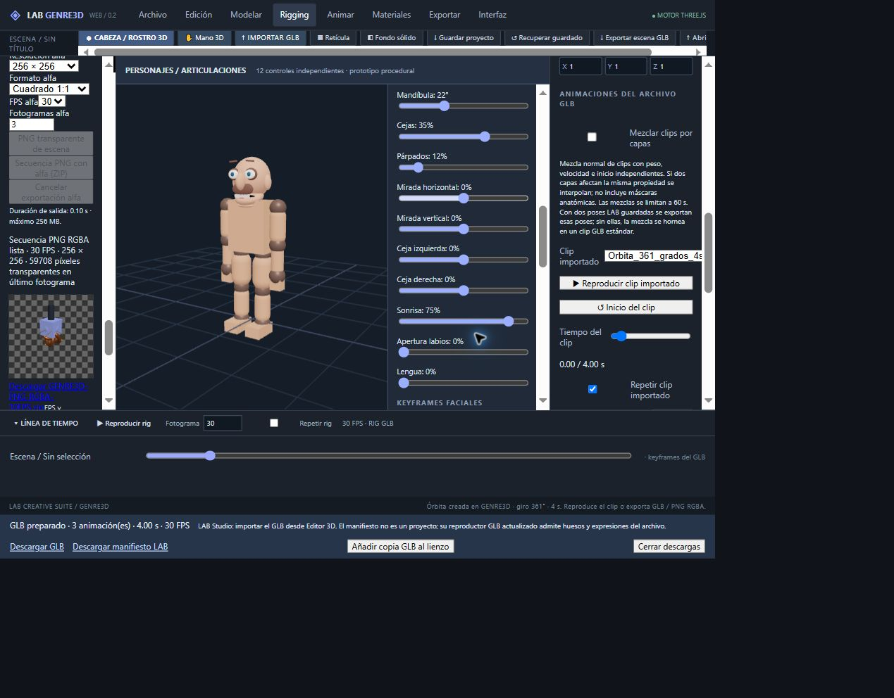

# Consolidación auditada · 31 octubre 2026

Base: main, 2e5e6382ecf2858402f61b80b75d1a7342818698. Alcance exclusivo: LAB GENRE3D. LAB Studio no se modifica.

## Correcciones

- Abrir Animar o Rigging conserva el visor de escena. La mano y el editor facial quedan como acciones explícitas del menú.
- Animar despliega la timeline inferior y el panel de keyframes de objeto.
- Materiales abre el panel PBR cuando hay un GLB seleccionado; el menú también incluye acceso explícito a ese panel.
- Los borradores de keyframes de objeto se reinician al cambiar de selección o abrir un proyecto; no se aplican accidentalmente a otro modelo. Para conservarlos, crear la copia GLB con timeline antes de cambiar de selección.
- Reproducción de rig: bucle y final sin repetición usan el último keyframe guardado, en lugar de 240 fotogramas fijos.
- Preset Sonrisa activa sonrisa al 75 %.
- PBR: elimina multiplicación duplicada del color del preset, carga rugosidad/metalicidad del preset, bloquea aplicación durante procesamiento y rechaza repetición UV nula/no finita o rotación fuera de rango.
- Selector de preset PBR tiene etiqueta accesible explícita.

## Verificación local

`npm run test:consolidation` ejecuta regresiones de UI PBR, preset facial, aislamiento de timeline, modelos creativos, rigging/pesos/IK, exportación de rig, operaciones de malla y persistencia de proyecto v3. `npm run build` compila TypeScript y Vite.

La suite de UI usa mapas Three reales y un canvas mínimo para ejecutar las operaciones sin GPU. No sustituye la inspección visual.

## Interacción en producción antes de corregir

Pruebas en pestaña de auditoría independiente; proyecto del usuario conservado.

| Función | Resultado observado |
|---|---|
| Crear esfera y editar posición | Correcto |
| Duplicar | Nombre y copia creados |
| Espejo X | Escala X = -1 |
| Restablecer | Transformaciones iniciales recuperadas |
| Preset Serpiente | Selección y valores físicos actualizados |
| Giro 361 grados | Copia GLB creada con clip de 4 s; original conservado |
| Reproducir clip | Tiempo avanza |
| Aplicar PBR a submalla | Confirmación de material guardado |
| Crear brazo riggeado | 3 huesos y morph Volumen disponibles |
| Resolver IK | Distancia restante 0,001 |
| Guardar dos poses y reproducir | Fotograma avanza; detectado bucle fijo a 240 |
| Preset Sonrisa | Defectuoso: sonrisa permanecía a cero |
| Dos keyframes faciales | Interpolación y reproducción activas |
| Abrir Animar | Defectuoso: abría la mano automáticamente |

## Límites que siguen abiertos

El personaje/cabeza y la mano son modelos procedurales con segmentos rígidos. No constituyen un personaje anatómico de alta resolución con skinning facial. Los materiales originales son procedurales, no escaneos fotográficos. El editor PBR admite mapas externos. El rig lineal no es autorig humano. La edición topológica de submallas con pesos continúa bloqueada para preservar el rig; existe copia estática editable.

Las verificaciones anteriores no equivalen a certificar todos los botones, todas las combinaciones de parámetros ni el backend remoto Blender. No se repiten las pruebas manuales de mallas documentadas en AUDITORIA-MALLAS-BLENDER-2026-10-31.md.

## Verificación del primer despliegue

Cloudflare confirmó éxito para `507e77b5df7577d0f118c7e18b23e47d9111ddd3`, despliegue `92178311-44b1-4000-b668-7fc2232083a6`. Pruebas en https://lab-genre3d.pages.dev/:

- Animar y Rigging conservan la escena.
- Sonrisa = 75 %.
- Guardar un keyframe en Cubo y seleccionar Esfera: el borrador no aparece en Esfera.
- Dos poses en 0 y 30, sin repetición: reproducción termina en 30 y vuelve a mostrar Reproducir rig.
- Acero carga rugosidad 0,30 y metalicidad 0,85; aplicación PBR completada. Repetición UV = 0 se rechaza con mensaje.
- Personaje con keyframes faciales: generado como GLB y clip de 8 s reproducido en visor. La duración se extendió al último keyframe facial (240), aunque el campo de exportación era menor.
- Órbita creada con seis submallas y clip de 4 s.
- ZIP RGBA preparado: tres fotogramas, 256 × 256, 30 FPS; último fotograma con 59.708 píxeles transparentes. Es prueba corta, no certificación de salida 4K ni de importación Adobe.
- Exportar escena preparó enlaces GLB y manifiesto. No se certificó descarga a disco del dispositivo ni apertura en Adobe.
- Consola: errores observados de extensión MetaMask, con origen chrome-extension; no se observaron errores de ejecución del código GENRE3D durante esas pruebas.

Regresiones adicionales: animation-layers, imported-animation, imported-mesh-editing, bake-animation y clip-playback pasan.

