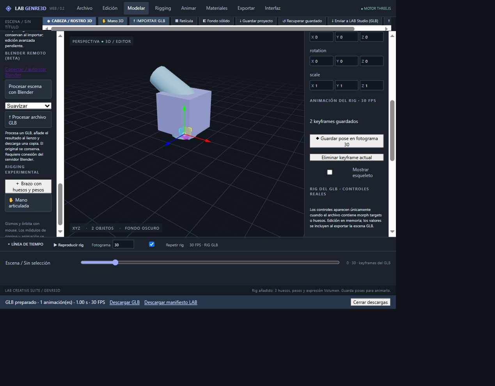

# Descarga explícita GLB — 30 octubre 2026

## Implementación
Commit d01ed33e0a4352c008bfd1cbd199e1cee1629506, main. Exportar prepara enlaces independientes «Descargar GLB» y «Descargar manifiesto LAB» con cantidad de clips, duración y FPS. Los enlaces mantienen los datos hasta cerrar descargas, reemplazar la exportación o cerrar la página; las URL temporales se revocan al liberar el resultado. Se conserva el comportamiento anterior del módulo exportador si un consumidor no proporciona onReady.

## Validación
- TypeScript/Vite: compilación correcta.
- tests/export-downloads.mjs: GLB y manifiesto preparados sin descargas automáticas; nombres seguros, duración y nombres de clip correctos; guías excluidas y visibilidad recuperada. Prueba ampliada: reapertura del GLB binario con GLTFLoader, reproducción del clip importado mediante AnimationMixer y transformación intermedia correcta. Esta prueba usa una pista de traslación; la prueba de rotación/weights del rig sigue registrada por separado.
- Web publicada: plantilla articulada, dos poses en fotogramas 0 y 30, Codo Z=60° y Volumen=1 en la segunda. Exportar muestra «GLB preparado · 1 animación(es) · 1.00 s · 30 FPS». Ambos enlaces aparecen.
- Clic directo en Descargar GLB: la captura waitForEvent('download') agota 10 segundos sin archivo verificable. No afirmar éxito ni fallo de la descarga a disco a partir de esa limitación. No repetir esa captura sin información nueva.

## Pendientes
Verificar archivo descargado a disco y reapertura del rig animado desde ese archivo. La interfaz aún no reproduce los clips originales de un GLB importado; el reproductor actual corresponde a los keyframes guardados dentro de LAB. Exportaciones de los módulos Mano/Cabeza y render alfa continúan pendientes.

