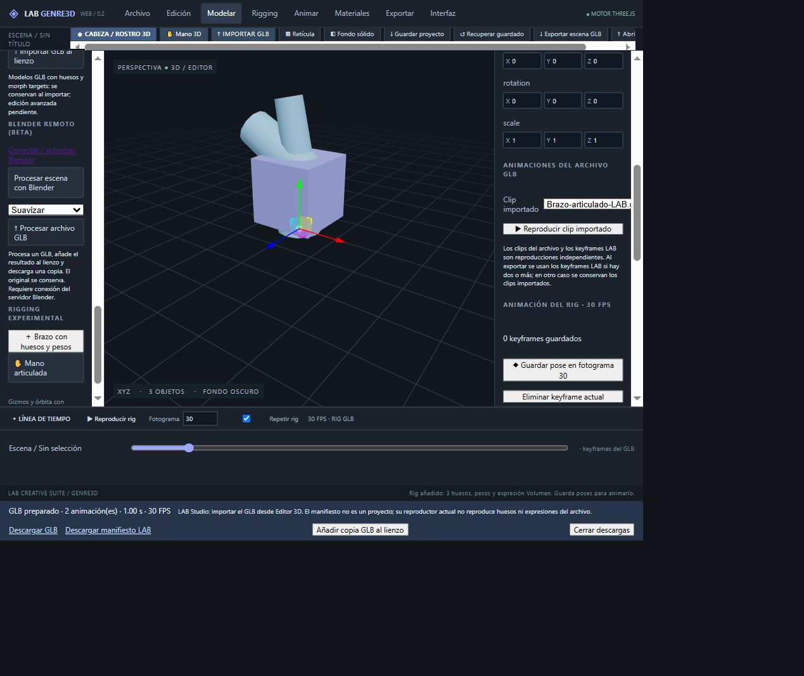

# Reproducción GLB importado — 30 octubre 2026

Implementación: 400215b7e649ae3ba4c2d51ec67ca31042b3456c en main, sin modificaciones de LAB Studio.

## Funciones
- Selector de clip y reproducción/pausa de animaciones incluidas en GLB importados, con mixer restringido a la jerarquía de ese archivo. Pausar conserva la pose.
- Reexportación: si el modelo tiene al menos dos keyframes LAB se exporta ese clip; en otro caso se conservan los clips del archivo. Las pistas importadas se enlazan a UUID para aislar modelos con nombres repetidos; una vinculación no resuelta informa error en vez de exportar silenciosamente una pista equivocada.
- Añadir copia GLB al lienzo: reabre el mismo Blob binario preparado para descargar. Permite revisar la portabilidad dentro de GENRE3D sin descarga intermedia; no acredita descarga a disco.
- Etiqueta Exportar escena GLB y explicación del alcance actual de LAB Studio. El manifiesto JSON no es un proyecto Studio; su importador 3D carga la escena pero no reproduce las animaciones esqueléticas/morph del archivo.

## Validación
- Compilación TypeScript/Vite correcta.
- tests/imported-animation.mjs aprobado: conservación de clips al reexportar/reabrir, nombres repetidos aislados, pistas originales intactas y error de enlace inexistente.
- Cloudflare despliegue 7cfd39f0-e524-433b-b62b-7f6ee3863a7e: publicación exitosa confirmada en logs.
- Navegador publicado: plantilla con Codo Z de 0° a 60° y Volumen de 0 a 1, poses en frames 0 y 30. Exportación seguida de Añadir copia GLB al lienzo: selector reconoce «Brazo-articulado-LAB.glb · rig LAB · 1.00 s».
- Reproducción del clip importado y pausa: Codo Z=10,8° y Volumen=0,18 observados en inspector. La copia tiene 0 keyframes LAB: el movimiento procede del clip serializado.
- Reexportar escena con original y copia visibles muestra 2 animaciones de 1 s: conserva tanto keyframes del original como el clip importado de la copia.

## Límites
No se probó descarga a disco nuevamente. No se cambió LAB Studio ni se afirma compatibilidad completa de animación con él. Clips importados se reproducen en bucle; no hay todavía scrub dedicado. Pausar antes de editar manualmente la pose. Render con alfa, animación de módulos procedurales, IK/FK y pintura de pesos continúan pendientes.

