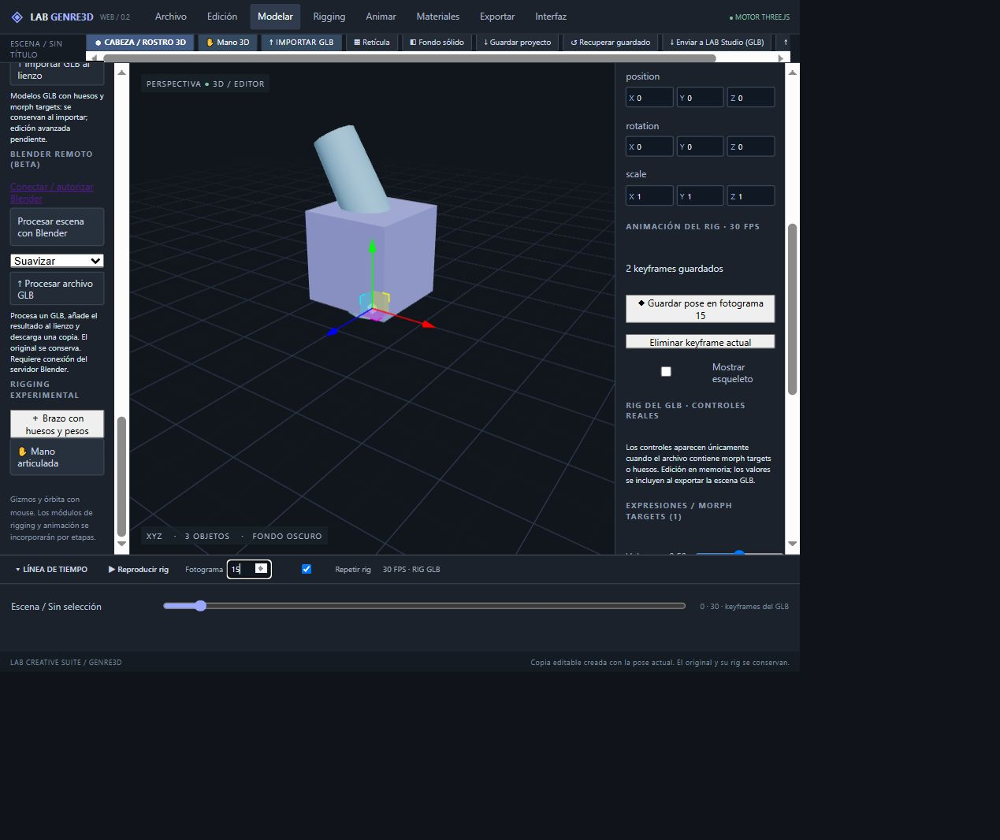

# Rig con pesos y validación web — 30 octubre 2026

## Implementación
Commit 557ede58509be80c144d2186f6f99aaf6d795d90 en main. Nueva acción «＋ Brazo con huesos y pesos» en el panel izquierdo, sección Rigging experimental. Genera una malla continua con 3 huesos (Base, Codo, Extremo), pesos normalizados y morph Volumen. El modelo entra en el flujo GLB existente: controles de huesos, keyframes, guardado y exportación.

No incluye auto-rig, pintura de pesos, IK/FK ni una anatomía detallada. La edición de topología del original articulado permanece protegida; utilizar Crear copia editable sin rig para congelar la pose.

## Validación
- Compilación local correcta; prueba tests/rig-template.mjs aprobada: pesos normalizados, deformación por hueso y roundtrip GLB conservando 3 huesos y morph nombrado.
- Cloudflare: logs del despliegue dc0232dd-2172-4830-b2cd-e32d4e36a51e confirman compilación y publicación exitosa del commit 557ede5.
- Web: nueva plantilla añadida desde su botón; inspector muestra 3 huesos y 1 morph; Vértices/Aristas/Caras del original deshabilitados por protección del rig.
- Guardadas poses en fotogramas 0 y 30, Codo Z=0° y 60°. En fotograma 15 el inspector muestra 30°.
- Volumen al final=1; guardada la pose de fotograma 30 con teclado End. En fotograma 15 muestra 0,5. La escritura automatizada con fill sobre range no produjo cambio; se usó teclado y lectura del valor DOM para comprobarlo.
- Reproducir rig avanza el fotograma (201 observado); pausa disponible.
- Crear copia editable sin rig muestra confirmación y habilita Vértices. Original sigue presente y al seleccionarlo mantiene 3 huesos y su expresión.

## Pendientes
La descarga y reapertura del GLB animado desde el navegador aún no están verificadas. No confundir las pruebas de pistas de animación y el roundtrip automático con la descarga real. Quedan IK/FK, pintura de pesos, rig automático, exportación de módulos procedurales y render de animación con alfa.

