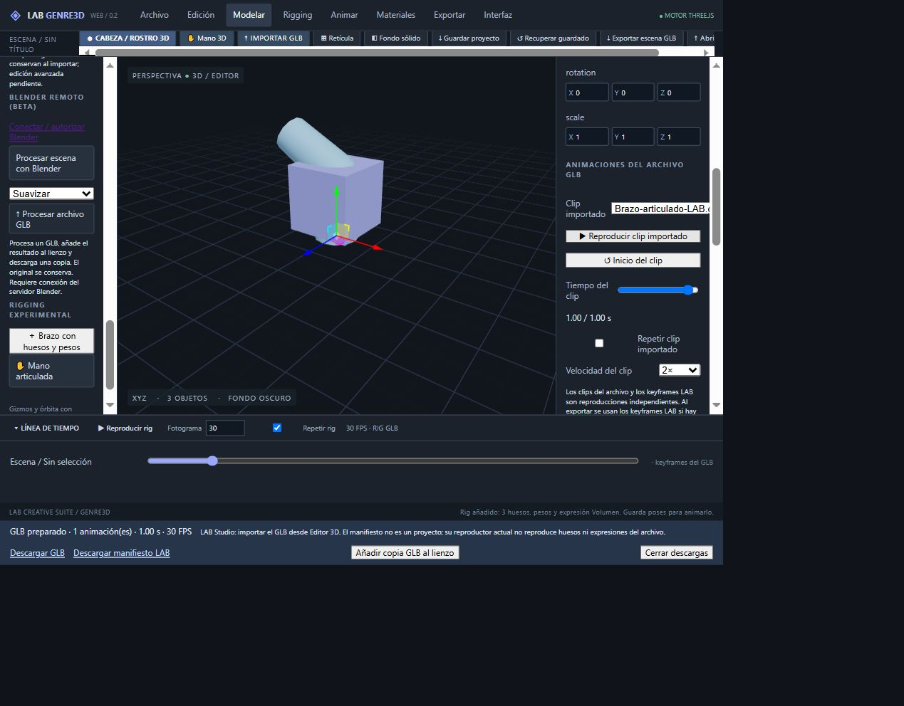

# Control de tiempo de clips GLB — 30 octubre 2026

## Implementación
Añadidos deslizador de tiempo en segundos, Inicio del clip, Repetir clip importado y selector de velocidad 0,25×/0,5×/1×/1,5×/2×. Al desactivar la repetición se detiene en la última pose. Reproducir desde el final reinicia el clip.

La búsqueda exacta se separa de los informes del reloj de reproducción para evitar realimentación. El inspector se refresca después de evaluar el mixer, incluso si el tiempo ya coincidía con el estado React. Seleccionar un modelo no evalúa el clip hasta una acción explícita de reproducción o búsqueda; conserva así su pose actual. Los controles de clip no modifican los keyframes LAB.

## Evidencia
- Compilación TypeScript/Vite correcta.
- tests/clip-playback.mjs aprobado: endpoint exacto, velocidad reducida, repetición, detención sin bucle, reinicio y límites del tiempo.
- Publicación final: commit 46b083219f9a0319e4105748c0058496516e8406, despliegue Cloudflare c72d1d83-79a0-42d6-aa55-d9a9a365d3f8 con éxito confirmado en logs.
- Web: fixture articulado de 1 segundo generado mediante exportar y añadir copia GLB. Antes de activar el clip se conserva Codo Z=60°.
- Inicio del clip: Codo Z=0°. Deslizador a 0,50 s: Codo Z=30° y Volumen=0,5. Extremo del deslizador 1,00 s: Codo Z=60°.
- Velocidad 2× y repetición desactivada: final en 1,00 / 1,00 s y botón vuelve a Reproducir, manteniendo la última pose. No se midió precisión temporal de pared con la automatización.
- La primera prueba detectó inspector visualmente retrasado una pose; fue corregido y se repitió solo la verificación afectada.

## Pendientes posteriores
Rigging avanzado (IK/FK y pintura de pesos), render con alfa y exportación de animaciones de módulos procedurales. Descarga a disco y compatibilidad animada con LAB Studio siguen fuera de lo validado; LAB Studio no fue modificado.

