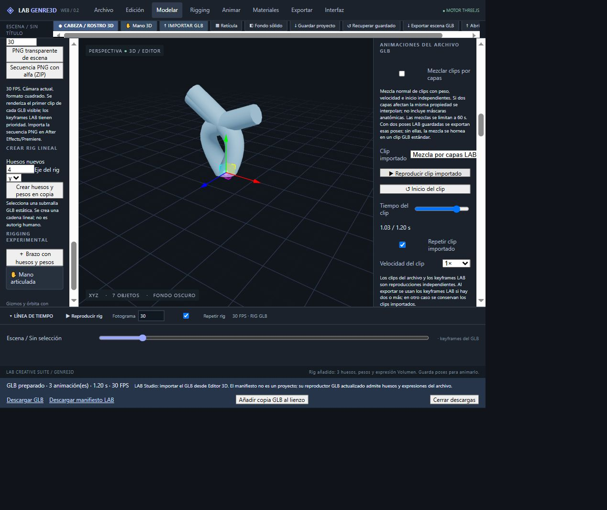

# Validación visual posterior — rigging y capas

Fecha de trabajo: 30 octubre 2026, America/Santiago. Pruebas sobre la versión publicada de GENRE3D (de1e5fd) y LAB Studio (3f4e012), mediante el navegador Work conectado. No se modificó código en esta etapa.

## GENRE3D
| Prueba pendiente | Acción y resultado observado |
|---|---|
| IK | Plantilla con tres huesos; extremo seleccionado: índice 2; objetivo inicial XYZ=1,2,0. Resolver devuelve «IK aplicado · distancia restante 0.001». La malla se observa doblada |
| Pintura de pesos | Ocultar cubo inicial para evitar superposición, activar pintura y hacer clic sobre el brazo. Mensaje: «Pesos actualizados en 39 vértices» |
| Deshacer de pesos | Pulsar Deshacer pincel de pesos. Mensaje: «Pincel de pesos deshecho» |
| Creación de rig | Crear copia con cuatro huesos. Mensaje confirma rig lineal sobre copia y selector muestra Hueso_01, Hueso_02, Hueso_03 y Hueso_04. Original conservado |
| Capas | Preparar un GLB con dos clips mediante exportación y adición de copias; activar ambas capas, peso 0,5 cada una e inicio de segunda=0,2 s. Deslizador muestra 1.20 / 1.20 s |
| Exportar mezcla | Exportar la escena con fuentes y mezcla: 3 animaciones, duración máxima 1,20 s |
| Reabrir mezcla | Añadir el GLB preparado como copia. Aparece un tercer clip «Mezcla por capas LAB · 1.20 s». Reproducir y pausar muestra 1.03 / 1.20 s y la jerarquía deformada. El recurso reabierto no depende de los controles de capas del proyecto original |

La prueba de capas en UI usa dos clips que afectan jerarquías distintas del mismo GLB. La interpolación de dos clips sobre una misma propiedad está cubierta por tests/animation-layers.mjs; no se confunden estas dos evidencias.

## LAB Studio
Cargar por URL el fixture público de GENRE3D, pausar, quitar bucle y llevar el original al final. Duplicar el modelo y llevar la copia al inicio. La copia aparece desplazada X=1 y recta; el original mantiene su forma doblada. La jerarquía muestra ambos modelos independientes y el clip del archivo sigue disponible en la copia. No se repitió la auditoría de las demás herramientas.

## Descargas
Se probó una alternativa a la captura de eventos ya fallida: downloadMedia sobre Descargar GLB. La herramienta devuelve explícitamente «Blob downloads are not supported by this browser». Esta limitación de automatización no acredita un fallo de descarga normal del editor. La descarga a disco, su reapertura desde ese archivo y la importación Adobe permanecen sin verificar. No repetir el mismo mecanismo sin cambios de capacidad.

## Pendientes que siguen abiertos
- Guardado/reapertura en UI después de pintar pesos; la persistencia ya está probada automáticamente.
- Reproducción visual completa de los clips transferidos de Mano y Personaje/Cabeza; generación y reconocimiento ya comprobados.
- Superposición/exportación de un GLB animado en composición 2D de Studio. Implementado y compilado, sin prueba UI completa.
- Descarga a disco y prueba de secuencia PNG a 30 FPS en After Effects/Premiere.
- Rigging sigue siendo lineal/CCD básico, sin autorig anatómico, límites de articulación ni mapa de calor de pesos. Capas sin máscaras anatómicas ni suma aditiva.

